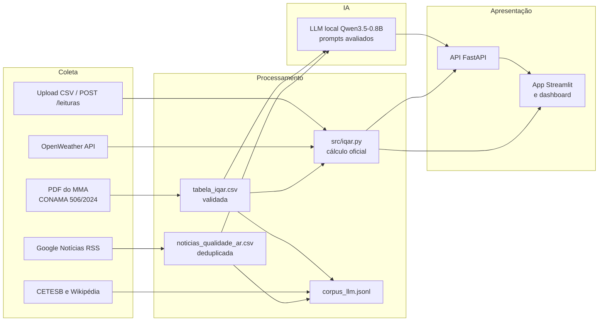

# Project Charter: Éter - Monitor Inteligente de Qualidade do Ar

## 1. Entendimento do negócio

### Contexto
A poluição do ar está entre os principais fatores ambientais de risco à saúde. No Brasil, episódios
de queimadas, tráfego intenso e atividade industrial elevam a concentração de poluentes, mas os
boletins oficiais usam índices técnicos pouco acessíveis ao público e cobrem poucas cidades. Ao
mesmo tempo, a informação sobre qualidade do ar está espalhada: números em APIs, faixas oficiais
em resoluções publicadas em PDF e o contexto (queimadas, fumaça, suspensão de aulas) em centenas
de notícias.

### Problema
Muitas pessoas não sabem avaliar se o ar da sua cidade está adequado para atividades externas e
correm riscos desnecessários em dias de alta poluição, sobretudo grupos sensíveis (crianças,
idosos, pessoas com asma, DPOC ou doenças cardíacas). Mesmo quem procura se informar encontra dados
técnicos de um lado e um volume grande de notícias do outro, sem uma síntese que diga o que está
acontecendo e o que fazer.

### Pergunta de negócio
Como transformar dados públicos e dispersos sobre qualidade do ar (medições, norma oficial e
notícias) em orientação simples, confiável e acionável para a população?

### Alinhamento com a Agenda 2030 e com ESG
- **ODS 3 (Saúde e Bem-Estar), meta 3.9:** reduzir doenças causadas por poluição do ar. O app
  traduz o IQAr em recomendações por perfil, com alertas mais conservadores para grupos sensíveis.
- **ODS 11 (Cidades Sustentáveis), meta 11.6:** reduzir o impacto ambiental negativo das cidades,
  com atenção à qualidade do ar. O app monitora capitais brasileiras.
- **ODS 13 (Ação Climática):** as notícias coletadas mostram que queimadas e fumaça dominam o
  noticiário sobre o tema; a sumarização torna esses episódios visíveis.
- **ODS 16 (Instituições Eficazes), meta 16.10:** acesso público à informação. O app usa a norma
  oficial (CONAMA 506/2024) e mostra a fonte de cada dado.
- **ESG:** o projeto atua no pilar **Ambiental** (monitorar e comunicar a qualidade do ar), no
  **Social** (proteger a saúde de grupos sensíveis) e no de **Governança** (rastreabilidade das
  fontes, norma oficial, logs de coleta, avaliação documentada dos modelos de IA e respostas que
  dizem de onde vieram).

## 2. Escopo

### Dentro do escopo
O projeto entrega uma aplicação web em Streamlit, organizada em múltiplas páginas com menu de
navegação, que consulta dados horários de poluentes (MP2.5, MP10, O3, NO2, SO2 e CO) para
capitais brasileiras, calcula o IQAr segundo a orientação técnica do MMA (CONAMA 506/2024) e
apresenta recomendações de saúde adaptadas ao perfil do usuário. A aplicação também exibe notícias
sobre qualidade do ar coletadas por web scraping, com nuvem de palavras e estatísticas, e permite
que o usuário envie e baixe medições próprias em CSV.

Uma API em FastAPI (`api/`) expõe os mesmos dados e regras de negócio (tabela oficial, cálculo do
IQAr, registro de leituras) para outros sistemas, independente da interface.

Um modelo de linguagem (LLM) rodando **localmente** (Qwen3.5-0.8B, biblioteca Transformers) é
servido pela API em `POST /processar_texto` para três tarefas: resumo de textos, classificação de
sentimento de notícias e perguntas respondidas com base na tabela oficial do IQAr.

Na entrega final (TP5), o projeto acrescenta a **sumarização automática do noticiário** (Tarefa 2,
opção 2): o LLM local lê as notícias coletadas, agrupadas por tema, local e período, e produz
resumos curtos e acionáveis. Os resumos, o sentimento das notícias e os dados de qualidade do ar
são apresentados num **dashboard interativo**, no qual o usuário escolhe o recorte e pede novos
resumos em tempo real.

### Fora do escopo
O projeto não substitui boletins oficiais nem orientação médica, não faz previsão de qualidade do
ar em dias futuros e não instala sensores físicos. O LLM não é treinado nem ajustado
(*fine-tuning*): o projeto usa um modelo aberto pré-treinado e trabalha a qualidade das respostas
por engenharia de *prompts* e avaliação.

## 3. Objetivos e métricas de sucesso

| Objetivo | Métrica | Meta | Situação |
|---|---|---|---|
| Traduzir índices técnicos em linguagem simples | Recomendação exibida para as consultas válidas | 100% | Atingida |
| Fidelidade ao método oficial | Diferença entre o IQAr calculado e o exemplo resolvido da orientação técnica do MMA | 0 pontos | Atingida (teste automatizado: 168, 86 e 60) |
| Performance | Tempo de resposta de uma consulta repetida (cache) | < 1 s | Atingida |
| Atualidade do conteúdo | Idade das notícias usadas na análise | coleta atualizável sob demanda | Atingida (scraper reexecutável) |
| Classificação de sentimento pelo LLM | Acerto em conjunto de teste rotulado (12 manchetes) | ≥ 90% | Atingida: 92% |
| Respostas fiéis à norma | Acerto em perguntas sobre a tabela oficial | 100% | Atingida: 3 de 3 |
| Tempo de resposta do LLM | Resumo curto na GPU de desenvolvimento (GTX 1050 Ti) | ≤ 15 s | Atingida: ~10 s |
| Sumarização do noticiário (TP5) | Resumos sem fatos ausentes das notícias de origem, em revisão manual | 0 erros factuais | Em andamento |
| Robustez da API | Falhas devolvidas com código HTTP, mensagem e sugestão | 100% das falhas previstas | Atingida (53 testes automatizados) |

## 4. Stakeholders

| Papel | Quem | Interesse |
|---|---|---|
| Usuários finais | Moradores de centros urbanos, praticantes de esportes ao ar livre | Decidir se é seguro sair e se exercitar |
| Grupos sensíveis | Crianças, idosos, pessoas com doenças respiratórias ou cardíacas | Alertas mais conservadores |
| Gestores públicos e imprensa | Secretarias de saúde e meio ambiente, comunicadores | Visão resumida dos episódios de poluição e do que se noticia sobre eles |
| Parceiros potenciais | Escolas, academias, organizações com agenda ESG | Comunicação de risco à população e a colaboradores |
| Provedores de dados | OpenWeather, MMA, CETESB, Wikipédia, Google Notícias | Uso adequado conforme termos de serviço |

## 5. Dados, IA e engenharia de prompts a serviço do problema

O problema tem duas partes: os números da qualidade do ar não dizem nada para a maioria das
pessoas, e o contexto (o que está acontecendo, onde e por quê) está diluído em centenas de
notícias. A solução combina técnicas de ciência de dados diferentes para cada parte.

### 5.1 Cada dado responde a uma parte da pergunta

| Dado | Como é obtido | O que resolve |
|---|---|---|
| Concentrações horárias de poluentes | API OpenWeather | *Quanto* de cada poluente há agora, em cada capital |
| Faixas oficiais do IQAr | Scraping do PDF do MMA (CONAMA 506/2024), validado | *O que esse número significa* segundo a norma vigente |
| Notícias sobre qualidade do ar | Scraping do feed do Google Notícias | *Por que* e *onde*: queimadas, fumaça, impactos relatados |
| Texto de referência | Scraping da CETESB e da Wikipédia | Vocabulário e explicações para a nuvem de palavras e o corpus |
| Medições do usuário ou de outros sistemas | Upload de CSV e `POST /leituras` | Aplicar o mesmo cálculo a dados próprios |

### 5.2 Onde entra a IA

Regras determinísticas resolvem bem a primeira parte: o IQAr é uma fórmula oficial, então o app a
implementa exatamente e a testa contra o exemplo da norma. A IA entra onde regras fixas não dão
conta, isto é, no **texto**:

- **Classificação de sentimento:** separa notícias de piora, de melhora e meramente informativas,
  o que permite medir o tom do noticiário ao longo do tempo.
- **Perguntas sobre a norma:** responde em linguagem natural usando só a tabela oficial como
  contexto, sem inventar números.
- **Sumarização (TP5):** condensa dezenas de notícias de um recorte (local, período, tema) em
  poucas frases que dizem o que aconteceu e o que fazer.

### 5.3 Engenharia de prompts guiada por avaliação

O projeto escolheu um modelo pequeno e local e compensou o tamanho com *prompts* bem desenhados,
medidos em quatro rodadas de avaliação (detalhes em `docs/model/ModelSelection.md`):

| Técnica | Onde | Efeito medido |
|---|---|---|
| Papel e idioma fixos na mensagem de sistema | todas as tarefas | respostas sempre em português e curtas |
| Definição explícita de cada rótulo + um exemplo por classe (*few-shot*) | sentimento | acerto do modelo escolhido de 67% para 92% |
| Contexto restrito ao necessário (*grounding*) e instrução de responder "só com a tabela" | perguntas | evita respostas fora da norma |
| Separar números que confundem o modelo (faixas do índice x concentrações) | perguntas | acerto de 33% para 100% |
| Formato e tamanho da saída especificados | resumo, sentimento | saídas validadas por esquema na API |
| Decodificação determinística (`do_sample=False`) | todas | mesma entrada, mesma saída: resultados reproduzíveis e testáveis |

A lição registrada na avaliação é que o *prompt* pesou tanto quanto o tamanho do modelo: as duas
correções de *prompt* tiveram mais efeito que trocar por um modelo maior e 3,7 vezes mais lento.

### 5.4 Por que um modelo local, e não uma API online

- **Custo zero por consulta**, o que permite processar todo o noticiário sem orçamento.
- **Privacidade e governança:** nenhum texto sai da máquina; não há dependência de termos de uso de
  terceiros sobre os dados enviados.
- **Reprodutibilidade:** modelo e versão fixos, decodificação determinística e avaliação
  reexecutável com `scripts/llm/avaliar_modelos.py`.
- **Funciona offline**, depois do download do modelo.

O custo é um modelo menos capaz que os comerciais. O projeto o aceita porque as tarefas são curtas
e trazem o contexto no *prompt*, e porque a avaliação mostrou acertos de 92% a 100%. A API foi
construída para trocar de modelo só com uma variável de ambiente (`ETER_LLM_MODELO`).

## 6. Metodologia (TDSP)

| Fase | Entregas | Status |
|---|---|---|
| Business Understanding | Este Charter: problema, pergunta de negócio, métricas, alinhamento a ODS e ESG | Concluído |
| Data Acquisition & Understanding | Scrapers (PDF do MMA, notícias, textos de referência), integração com a OpenWeather, upload e API de leituras, Data Summary Report | Concluído |
| Modeling | Cálculo do IQAr pela norma oficial; corpus para LLM; seleção e avaliação do LLM local; engenharia de *prompts* (`docs/model/ModelSelection.md`) | Concluído; sumarização do noticiário em andamento (TP5) |
| Deployment | App Streamlit multipage; API FastAPI com rotas de LLM, respostas validadas e tratamento de erros; dashboard final | Em andamento (dashboard na TP5) |
| Customer Acceptance | Validação com exemplos reais, testes automatizados e apresentação da solução | Em andamento (TP5) |

### Entregas por trabalho prático

| Entrega | Conteúdo |
|---|---|
| TP1 e TP2 | Proposta, protótipo, consulta à API, cálculo do IQAr e recomendações |
| TP3 | App multipage, web scraping, cache, upload de dados, API FastAPI, corpus para LLM |
| TP4 | LLM local (seleção e avaliação), rota `POST /processar_texto`, *response models*, tratamento de erros, tabela oficial extraída do PDF do MMA |
| TP5 | Sumarização automática do noticiário, dashboard final com IA, documentação completa e apresentação |

## 7. Arquitetura

Os scrapers em `scripts/scraping/` rodam separadamente e gravam CSV/TXT em `data/raw/`. O app
Streamlit (`app.py` + `pages/`) lê esses arquivos com cache (`src/state.py`), consulta a API
OpenWeather (cache de 10 minutos), calcula o IQAr com `src/iqar.py` e mantém histórico e uploads
no `st.session_state`. A API FastAPI (`api/`) reaproveita os mesmos módulos de `src/`, roda em
outro processo (`uvicorn api.main:app`) e serve também o LLM local (`src/llm.py`), carregado uma
única vez no primeiro pedido. O app conversa com o LLM pela API, então a interface continua
funcionando mesmo numa máquina sem o modelo instalado.

### Decisão sobre scraping dinâmico (Selenium)
O log de coleta (`data/raw/log_coleta_iqar.csv`) mostrou, desde a primeira versão, que a página
da CETESB retornava **0 tabelas** extraídas só com `requests` + BeautifulSoup. A hipótese inicial
era que o conteúdo fosse montado via JavaScript, então `scripts/scraping/scrape_iqar.py` passou a
renderizar essa fonte com um Chrome headless (Selenium + `webdriver-manager`, listada em
`FONTES_DINAMICAS`) antes de extrair as tabelas.

Testado com internet de verdade, o resultado continuou **0 tabelas mesmo com Selenium**. Ou seja,
a hipótese de "precisa de JavaScript" não se confirmou: a página não apresenta os padrões num
elemento `<table>`. A CETESB segue como fonte de texto (nuvem de palavras).

### Fonte da tabela oficial (TP4)
A tabela de faixas do IQAr passou a vir da **orientação técnica do MMA** (jan/2025), que publica o
Quadro 1 da Resolução CONAMA 506/2024 em PDF. O scraper encontra o link do PDF na página do MMA
(Beautiful Soup), extrai o Quadro 1 com pdfplumber e valida a estrutura antes de gravar
`data/raw/tabela_iqar.csv`. O cálculo do app (`src/iqar.py`) lê as faixas desse arquivo. A tabela
no código ficou só como reserva, usada se o PDF e a cópia local em `data/external/` falharem. A
coluna `fonte` e o log de coleta registram qual caminho foi usado. A mudança também atualizou a
norma: a CONAMA 491/2018 tinha MP10 "Boa" até 50 µg/m³, MP2.5 "Boa" até 25 µg/m³ e outras faixas
para o SO2. O cálculo passou a seguir o arredondamento e o exemplo resolvido da orientação.

### Escolha da funcionalidade de IA da entrega final (TP5)
Entre memória conversacional, sumarização e agentes, o projeto escolheu a **sumarização**:

- **Encaixa no dado que mais cresce:** o noticiário tem centenas de itens e é a fonte que mais
  pede síntese.
- **É a tarefa mais confiável para um modelo pequeno:** cada resumo parte de um contexto fornecido
  no *prompt*, como nas tarefas que já atingiram 92% a 100% de acerto. Conversas longas (memória) e
  decisões em várias etapas (agentes) exigem mais do modelo e erram mais.
- **Gera insight acionável e verificável:** cada resumo pode ser conferido contra as notícias de
  origem, que o dashboard exibe lado a lado.

## 8. Riscos e mitigação

| Risco | Impacto | Mitigação |
|---|---|---|
| API fora do ar ou limite de requisições excedido | Sem dados em tempo real | Cache com TTL e modo simulado automático |
| Mudança no HTML das páginas ou no PDF oficial | Scraper quebra | Extração validada, log de coleta, cópia local do PDF e tabela de reserva no código |
| Mudança na norma do IQAr | Índice desatualizado | Tabela lida do documento oficial; reserva e testes apontam divergências |
| Leitura horária difere das médias oficiais | Índice impreciso | Aviso explícito de aproximação na interface |
| Upload com formato incorreto | Erros na aplicação | Validação de colunas, tipos e poluentes com mensagens claras |
| LLM inventa fatos (alucinação) | Insight errado | Contexto fornecido no *prompt*, instrução de usar só esse contexto, saídas validadas e fontes exibidas ao lado do resumo |
| Hardware limitado (GPU de 4 GB) | Lentidão ou falta de memória | Modelo de 0,8B em FP16, limites de tempo (504) e de fila (503 com Retry-After) |
| LLM ou dependências indisponíveis | Funções de IA fora do ar | API e app seguem funcionando sem o modelo; erros 503 dizem o que instalar |
| Ruído nas notícias (manchetes agregadas, veículos repetidos) | Resumos piores | Deduplicação por título e limpeza do campo de resumo antes da sumarização |
| Exposição da chave de API | Uso indevido | `secrets.toml` no `.gitignore` e Secrets do Streamlit Cloud |
